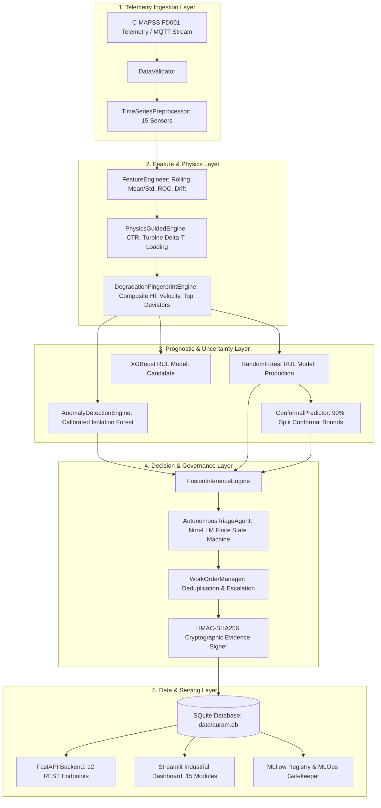

# AURA-M Technical Architecture & System Engineering

## 1. System Engineering Philosophy

AURA-M (*Autonomous, Uncertainty-Aware Reliability Intelligence*) is designed as a mission-critical industrial predictive maintenance architecture for connected asset fleets. Rather than treating prognostics as an isolated curve-fitting task, AURA-M operates on a closed-loop engineering paradigm:

1. **Physical Grounding**: Telemetry from operating turbofans is mapped into normalized physical degradation coordinates.
2. **Dual-Model Verification**: Supervised Remaining Useful Life (RUL) regression is corroborated by unsupervised anomaly detection.
3. **Statistical Guarantees**: Point estimates are wrapped in finite-sample distribution-free conformal prediction intervals.
4. **Deterministic Decision Governance**: Maintenance triage is executed by an auditable, non-LLM policy engine.
5. **Aviation-Grade Auditability**: All actions generate cryptographically signed HMAC-SHA256 evidence reports.

---

## 2. Architectural Blueprint

---

## 3. Mathematical Formulations

### 3.1 Piecewise-Linear RUL Target
In turbofan engines, mechanical components do not degrade measurably during early cycles. Following aerospace domain consensus, the target Remaining Useful Life $y_i(t)$ at operational cycle $t$ for engine $i$ with maximum lifespan $T_i$ is formulated as:

$$y_i(t) = \min(RUL_{max}, T_i - t), \quad \text{where } RUL_{max} = 125 \text{ cycles}$$

### 3.2 Composite Health Index ($HI$)
The Health Index maps multi-sensor baseline deviations into a normalized scalar $HI \in [0, 1]$:

$$HI(t) = 1.0 - \min\left(1.0, \frac{1}{K} \sum_{k=1}^K \left|\frac{s_k(t) - \mu_{k, base}}{\sigma_{k, base}}\right| \cdot \frac{1}{\gamma_k}\right)$$

where:
- $s_k(t)$ is the current filtered value of sensor $k$.
- $\mu_{k, base}, \sigma_{k, base}$ are the mean and standard deviation computed over the engine's first 10 healthy baseline cycles.
- $\gamma_k$ is a sensor sensitivity normalization constant ($\gamma \approx 3.0$).
- Degradation velocity is computed as: $v_{deg}(t) = \frac{HI(t - \Delta t) - HI(t)}{\Delta t}$.

### 3.3 Official NASA Asymmetric Scoring Function
Predictive maintenance penalties are inherently asymmetric. Overestimating remaining life risks catastrophic in-flight shutdown, while underestimating causes premature overhaul. The NASA scoring function penalizes late predictions exponentially harder than early predictions:

$$S = \sum_{i=1}^N s_i, \quad s_i = \begin{cases} e^{-\frac{d_i}{13}} - 1, & d_i < 0 \quad (\text{Early Alert}) \\ e^{\frac{d_i}{10}} - 1, & d_i \ge 0 \quad (\text{Late Alert / Failure Risk}) \end{cases}$$

where $d_i = \hat{y}_i - y_i$ is the prediction residual in cycles.

### 3.4 Split Conformal Prediction Intervals
Given a held-out calibration set of $n$ engines $(X_1, Y_1), \dots, (X_n, Y_n)$ independent of training data, non-conformity scores are defined as:

$$R_i = |Y_i - \hat{\mu}(X_i)|$$

For a desired coverage level $1 - \alpha = 0.90$, the conformal quantile $\hat{q}$ is the $\lceil(n+1)(1-\alpha)\rceil / n$ empirical quantile of $\{R_1, \dots, R_n\}$. For any new engine telemetry $X_{new}$, the valid prediction interval is:

$$C(X_{new}) = [\hat{\mu}(X_{new}) - \hat{q}, \; \hat{\mu}(X_{new}) + \hat{q}]$$

This guarantees marginal coverage:

$$P(Y_{new} \in C(X_{new})) \ge 1 - \alpha$$

### 3.5 Composite Fleet Risk Index
The multi-factor fleet risk index $R_{fleet} \in [0, 1]$ ranks all operational engines according to urgency:

$$R_{fleet} = w_1 \cdot \left(1 - \frac{RUL}{RUL_{max}}\right) + w_2 \cdot P_{anom} + w_3 \cdot (1 - HI) + w_4 \cdot \min\left(1.0, \frac{\text{Width}}{W_{max}}\right)$$

where $w_1 = 0.40, w_2 = 0.25, w_3 = 0.20, w_4 = 0.15$.

---

## 4. Subsystem Specifications

### 4.1 Data Pipeline & Preprocessing
- **Source**: NASA C-MAPSS FD001 (Sea-level flight, single fault mode: HPC degradation).
- **Pruning**: 7 constant-variance columns (s1, s5, s6, s10, s16, s18, s19) and operational settings with zero predictive power are removed.
- **Retained Channels**: 14 dynamic sensors (s2, s3, s4, s7, s8, s9, s11, s12, s13, s14, s15, s17, s20, s21) + setting 1 and setting 2.
- **Leakage Prevention**: All MinMax scalers are fitted strictly on training engine lifespans. Test engines and calibration engines are transformed using pre-fitted parameters.

### 4.2 Autonomous Triage Finite State Machine
The maintenance triage agent operates as a deterministic decision graph:
- **State 1: NORMAL_MONITORING**: $RUL > 45$ cycles, $HI > 0.60$, $P_{anom} < 0.50$, Uncertainty $\le 45$.
- **State 2: SCHEDULED_INSPECTION**: $20 < RUL \le 45$ cycles or $HI \le 0.60$. Priority: Medium. Assigned to Level 2 Line Maintenance.
- **State 3: CRITICAL_MAINTENANCE**: $RUL \le 20$ cycles. Priority: High/AOG. Assigned to Level 3 Propulsion Overhaul.
- **State 4: HUMAN_VERIFICATION_REQUIRED**: Uncertainty width $> 45$ cycles OR severe anomaly ($P_{anom} > 0.70$) conflicting with high predicted RUL ($RUL > 60$). Escalated to Senior Reliability Specialist.

### 4.3 Stateful Work-Order Deduplication & Escalation
1. **Query**: Before issuing a ticket, `WorkOrderManager` queries active orders (`OPEN`, `IN_PROGRESS`) for the given `engine_id`.
2. **Suppression**: If an order exists and degradation is progressing as predicted, the alert is suppressed, updating the existing ticket's telemetry breadcrumbs without creating duplicates.
3. **Atomic Escalation**: If $v_{deg}$ accelerates or RUL drops across a severity threshold (e.g., from 35 to 12 cycles), the existing ticket is updated in place, elevated to `CRITICAL`, and flagged with an escalation event audit log.

### 4.4 Edge AI & Model Optimization
- **Export Framework**: `skl2onnx` with Opset 14.
- **Execution Engine**: `onnxruntime` with Graph Optimization Level `ORT_ENABLE_ALL`.
- **Target Topology**: Direct execution on ARM Cortex-A / x86 embedded flight management computers.
- **Fallback**: Graceful automatic fallback to native Pickle model if the ONNX runtime is unavailable.

---

## 5. Security & Aviation Compliance
- **HMAC-SHA256 Signing**: Every work order contains a cryptographic digest calculated over `(engine_id, cycle, rul, interval, health_index, timestamp)` using an enterprise secret key.
- **Audit Trails**: All state transitions, retraining runs, and work-order updates are appended to an immutable SQLite audit log table (`audit_logs`).
- **RBAC**: Four strict authorization roles (`ADMIN`, `ENGINEER`, `OPERATOR`, `AUDITOR`) enforce principle of least privilege.
